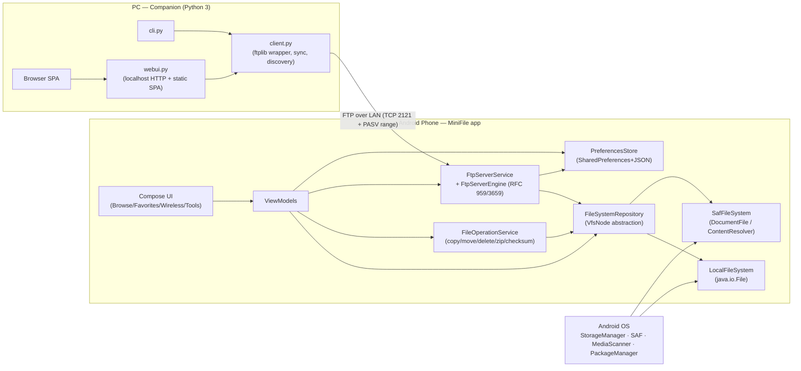

# MiniFile — System Architecture

> **Status:** v1.0 (authoritative for implementation by `coder-android`, `coder-companion`, verified by `tester`).
> **Companion doc:** [DESIGN.md](./DESIGN.md) — product/UX specification. Section references like *DESIGN §5.2* point there.

---

## 1. Repository Layout & Build Environment

```
minifile/
├── DESIGN.md, ARCHITECTURE.md, README.md
├── settings.gradle.kts, build.gradle.kts, gradle.properties, gradlew, gradle/
│   └── libs.versions.toml                 # single source of dependency versions
├── app/                                   # Android application (Kotlin + Compose)
│   ├── build.gradle.kts
│   └── src/
│       ├── main/AndroidManifest.xml
│       ├── main/java/com/minifile/explorer/…   # see §3
│       ├── main/res/…                     # strings.xml, xml/file_paths.xml, icons
│       └── test/java/com/minifile/explorer/…   # pure-JVM unit tests (JUnit 4)
├── companion/                             # PC Companion (pure Python 3, stdlib only)
│   ├── minifile.py                        # shim → minifile_companion.__main__
│   ├── minifile_companion/
│   │   ├── __init__.py, __main__.py
│   │   ├── client.py      # FTP client wrapper, recursive ops, sync, discovery
│   │   ├── cli.py         # argparse commands (DESIGN §4.3)
│   │   ├── webui.py       # localhost HTTP server + JSON API (§6.3)
│   │   ├── gui.py         # `gui` entry: Tkinter if importable, else delegates to webui
│   │   ├── config.py      # ~/.config/minifile/config.json
│   │   ├── scanner.py     # LAN discovery
│   │   ├── textutil.py    # encoding detection helpers
│   │   └── static/        # index.html, app.css, app.js (no build step)
│   ├── tests/             # unittest suite with embedded FTP server fixture (§8.3)
│   └── README.md
└── .worktrees/            # (git-ignored) per-worker worktrees
```

### 1.1 Toolchain (all cached locally; builds must pass `--offline`)

| Component | Version | Source |
|-----------|---------|--------|
| JDK | 21 (Temurin) | `JAVA_HOME=/usr/local/google/home/chii/.jdks/jdk21` |
| Android SDK | platforms 35 (36 available), build-tools 35.0.0 | `ANDROID_HOME=/usr/local/google/home/chii/Android/Sdk` (`local.properties` present, git-ignored) |
| Gradle | 8.10.2 (`gradle-8.10.2-bin`, wrapper committed) | `~/.gradle/wrapper/dists` |
| AGP | **8.7.1** (fallback 8.4.0; both cached; 8.7.1 requires Gradle ≥ 8.9 ✓) | `~/.gradle/caches` |
| Kotlin | **2.0.21** + `org.jetbrains.kotlin.plugin.compose` 2.0.21 | cached |
| Compose | BOM `2024.10.01` (ui/foundation 1.7.5), `material3` **1.3.1** pinned explicitly if the BOM's 1.3.0 is not cached, `material-icons-extended` 1.7.6 | cached |
| AndroidX | `core-ktx` 1.15.0, `activity-compose` 1.9.3, `lifecycle-runtime-compose`/`viewmodel-compose` 2.8.7, `lifecycle-service` 2.8.7, `documentfile` 1.0.1, `appcompat` 1.7.1 (only for `FileProvider`/compat if needed — otherwise `core`) | cached |
| Coroutines | `kotlinx-coroutines-android` 1.9.0 | cached |
| Thumbnails (optional) | `io.coil-kt:coil-compose` 2.6.0 — **must be removable without breaking the build** (feature-flag `BuildConfig.THUMBNAILS`) | cached per researcher |
| Tests | JUnit 4.13.2 (pure JVM). **No Robolectric/Mockito/MockK** (not cached) → all testable logic must be Android-free (§3.2 layering). | cached |
| Python | 3.13 (`/usr/bin/python3`); `tkinter` **absent** on this host; no Node.js. | system |

Build commands (from a worktree):
```bash
export JAVA_HOME=/usr/local/google/home/chii/.jdks/jdk21 ANDROID_HOME=/usr/local/google/home/chii/Android/Sdk
./gradlew --offline assembleDebug testDebugUnitTest      # try offline first; drop --offline only if a dep is truly missing
python3 -m unittest discover -s companion/tests -v
```
Debug APK path: `app/build/outputs/apk/debug/app-debug.apk`. `gradle.properties` must set `org.gradle.jvmargs=-Xmx3g`, `android.useAndroidX=true`, `kotlin.code.style=official`.

Android app config: `applicationId "com.minifile.explorer"`, `namespace "com.minifile.explorer"`, `minSdk 26`, `targetSdk 35`, `compileSdk 35`, `versionCode 1`, `versionName "1.0.0"`, `buildFeatures { compose = true; buildConfig = true }`.

**Reproducibility rules (binding):**
- **Never** use `kotlin { jvmToolchain(17) }` or `java { toolchain { … } }` — Gradle would try to auto-provision a JDK 17 and fail offline. Instead set directly:
  ```kotlin
  android { compileOptions { sourceCompatibility = JavaVersion.VERSION_17; targetCompatibility = JavaVersion.VERSION_17 } }
  kotlin { compilerOptions { jvmTarget.set(org.jetbrains.kotlin.gradle.dsl.JvmTarget.JVM_17) } }
  ```
  JDK 21 (`JAVA_HOME`) runs Gradle and compiles with `--release`-style targeting of 17.
- Git worktrees do **not** contain `local.properties` (git-ignored) → `ANDROID_HOME` must be exported in every build shell (or copy `local.properties` into the worktree; it stays ignored).
- **Milestone M0 (first commit of `feat/android-app`)**: an empty Compose skeleton app (`MainActivity` showing "MiniFile") that passes `./gradlew --offline assembleDebug testDebugUnitTest` with one trivial JUnit test, committed *before* any feature code. Every dependency added later must also resolve with `--offline`; if one does not, pick a cached alternative rather than dropping `--offline`.
- Lock the versions in `gradle/libs.versions.toml`; no dynamic (`+`) versions; `repositories { google(); mavenCentral() }` only.

---

## 2. System Context



---

## 3. Android App Architecture

### 3.1 Pattern
**MVVM + unidirectional data flow** with Kotlin coroutines/`StateFlow`. Manual dependency wiring via a single `AppContainer` (no Hilt/Dagger — not needed, keeps the build minimal and offline-safe). Single `MainActivity` hosting `MiniFileApp()` composable with a state-driven router.

### 3.2 Layering & Package Map (`com.minifile.explorer`)

| Package | Responsibility | Android dependency? | Unit-testable on JVM? |
|---------|----------------|---------------------|-----------------------|
| `core.vfs` | `VfsNode`, `VfsPath`, `FileSystem` interface, `LocalFileSystem` (java.io), `FileSystemRepository` (routes paths → backend), `PathUtils` (normalization, name validation, unique naming, natural sort) | **No** (pure Kotlin/JVM) | ✅ |
| `core.ops` | `FileOperations` (copy/move/delete/rename/mkdir/create, conflict policy, progress), `ZipArchiver` (compress/extract + zip-slip guard), `ChecksumCalculator`, `NomediaManager`, `TextFileCodec` (encoding detect/decode/encode, EOL) | **No** | ✅ |
| `core.ftp` | `FtpServerEngine`, `FtpSession`, `FtpCommandHandler`, `FtpPathResolver` (virtual root jail), `FtpListingFormatter` (LIST/MLSD), `FtpConfig`, `FtpEvent` | **No** (uses `java.net`, `FileSystem` interface) | ✅ (real sockets on loopback) |
| `core.model` | `Favorite`, `SortSpec`, `ViewMode`, `AppSettings`, `ClipboardState`, `OperationResult` | No | ✅ |
| `data` | `SafFileSystem` (DocumentFile), `AndroidVolumeProvider` (`StorageManager`), `PersistedTreeStore`, `FavoritesRepository`, `SettingsRepository` (SharedPreferences impl of `KeyValueStore`), `InstalledAppsRepository` (PackageManager), `MediaScanNotifier` | Yes | Interfaces tested with fakes; impls via manual/instrumented checks |
| `service` | `FileOperationService` (foreground, progress notifications, cancel), `FtpServerService` (foreground, wake/wifi locks), `VolumeChangeReceiver` | Yes | — |
| `ui` | Compose screens, `MiniFileApp` router, theme, components (`FileListItem`, `BreadcrumbBar`, `ClipboardBar`, `SelectionBottomBar`, `FavoritePickerSheet`, `ConflictDialog`, `ProgressSheet`), screens: `home`, `browser`, `favorites`, `wireless`, `tools`, `editor`, `archive`, `apps` | Yes | — |
| `di` | `AppContainer` (wires everything; `MiniFileApplication.container`) | Yes | — |

**Rule:** nothing in `core.*` may import `android.*`. Android-specific needs are injected as small interfaces (`Clock`, `KeyValueStore`, `MediaScanNotifier`, `Logger`).

### 3.3 Threading
- `Dispatchers.IO` for all filesystem work; listing runs in `viewModelScope` with cancellation on navigation.
- `FileOperationService` runs each `OperationJob` in a `SupervisorJob` + `Dispatchers.IO`, exposes `StateFlow<List<OperationProgress>>` via a bound `Binder`/singleton `OperationRegistry`.
- `FtpServerEngine` uses a dedicated `Executors.newCachedThreadPool` (blocking socket I/O is clearer and testable without coroutines); emits `FtpEvent`s via a `MutableSharedFlow` (buffer 512, DROP_OLDEST) consumed by the Wireless screen and the notification updater.

### 3.4 Navigation & UI State
```kotlin
sealed interface Route {
    data object Home : Route                        // Storage Home (Browse tab root)
    data class Browser(val path: VfsPath) : Route
    data object Favorites : Route
    data object Wireless : Route
    data object Tools : Route
    data class Editor(val path: VfsPath, val forceText: Boolean = false) : Route
    data class ArchivePreview(val path: VfsPath) : Route
    data object InstalledApps : Route
    data class AppDetail(val packageName: String) : Route
    data class ToolsPage(val page: ToolsPageId) : Route
}
enum class Tab { BROWSE, FAVORITES, WIRELESS, TOOLS }
```
`NavState` = `currentTab` + per-tab back stacks (`ArrayDeque<Route>`), kept in `MainViewModel`, saved via `SavedStateHandle` (paths serialized as strings). `BackHandler` follows DESIGN §1.1.

**`BrowserUiState`**
```kotlin
data class BrowserUiState(
    val path: VfsPath,
    val breadcrumbs: List<Crumb>,
    val entries: List<VfsNode>,            // already sorted + filtered
    val isLoading: Boolean,
    val error: BrowserError?,              // NoPermission, SafNotMounted, Unavailable, Io(msg)
    val sort: SortSpec, val viewMode: ViewMode, val showHidden: Boolean,
    val query: String, val recursiveSearch: Boolean, val searchResults: List<SearchHit>?,
    val selection: Set<VfsPath>, val selectionMode: Boolean,
    val clipboard: ClipboardState?,        // shared app-wide via ClipboardHolder
    val isFavorite: Boolean, val hasNomedia: Boolean, val isReadOnly: Boolean,
)
```

### 3.5 Clipboard & Favorite Picker contract
```kotlin
data class ClipboardState(val items: List<VfsPath>, val mode: TransferMode /* COPY, MOVE */)
object ClipboardHolder { val state: StateFlow<ClipboardState?> ; fun set(..); fun clear() }

// Launched from: SelectionBottomBar.More, ClipboardBar.ToFavorite, row menu "Copy to…/Move to…"
@Composable fun FavoritePickerSheet(
    request: TransferRequest,                 // items + initial mode
    favorites: List<FavoriteWithStatus>,      // status: Available | Unavailable(reason) | Disabled(reason)
    onPick: (Favorite, TransferMode) -> Unit, // starts FileOperationService job immediately
    onBrowse: () -> Unit, onAddCurrent: () -> Unit, onDismiss: () -> Unit,
)
```
Disabled reasons computed by `TransferTargetValidator.validate(items, mode, target)`: `SameDirectory`, `InsideSource`, `ReadOnlyTarget`, `TargetUnavailable`. **Unit-tested.**

---

## 4. Virtual File System (VFS)

### 4.1 Data Model
```kotlin
/** Opaque, serializable location. Exactly one of the two forms. */
sealed interface VfsPath {
    val displayName: String
    data class Local(val absolutePath: String) : VfsPath                      // "/storage/emulated/0/Download"
    data class Saf(val treeUri: String, val documentId: String) : VfsPath     // tree root + child document id
    fun serialize(): String  // "file:///…" or "saf:<treeUri>#<documentId>"  — used in prefs & SavedState
    companion object { fun parse(s: String): VfsPath }
}

data class VfsNode(
    val path: VfsPath,
    val name: String,
    val isDirectory: Boolean,
    val size: Long,                 // bytes; -1 unknown (SAF dir)
    val lastModified: Long,         // epoch ms; 0 unknown
    val mimeType: String?,          // null → derive from extension
    val isHidden: Boolean,          // name.startsWith('.')
    val canRead: Boolean, val canWrite: Boolean,
    val isSymlink: Boolean = false,
    val childCount: Int = -1,       // -1 unknown/not computed
    val hasNomedia: Boolean = false,// directories only
    val posixPermissions: String? = null, // "rwxr-xr-x" (Local only)
)

data class Volume(
    val id: String,            // uuid or "primary"
    val name: String,          // "Internal Storage", "SD Card", "USB Drive (SanDisk)"
    val kind: VolumeKind,      // PRIMARY, SD_CARD, USB_OTG, APP_DATA, APP_OBB, MOUNTED_TREE (generic "Mount a folder…" SAF grant, DESIGN §1.2)
    val root: VfsPath?,        // null until a SAF grant exists
    val totalBytes: Long, val freeBytes: Long,   // -1 when unknown
    val isMounted: Boolean, val needsSafGrant: Boolean,
)
```

### 4.2 `FileSystem` interface (implemented by `LocalFileSystem`, `SafFileSystem`, test `FakeFileSystem`)
```kotlin
interface FileSystem {
    fun supports(path: VfsPath): Boolean
    suspend fun stat(path: VfsPath): VfsNode?
    suspend fun list(dir: VfsPath, includeHidden: Boolean): List<VfsNode>   // also sets hasNomedia on dir children
    suspend fun child(dir: VfsPath, name: String): VfsPath
    suspend fun parent(path: VfsPath): VfsPath?
    suspend fun exists(path: VfsPath): Boolean
    suspend fun createDirectory(dir: VfsPath, name: String): VfsPath
    suspend fun createFile(dir: VfsPath, name: String, mime: String = "application/octet-stream"): VfsPath
    suspend fun delete(path: VfsPath): Boolean              // non-recursive; recursion in FileOperations
    suspend fun rename(path: VfsPath, newName: String): VfsPath
    suspend fun moveWithinSameBackend(src: VfsPath, dstDir: VfsPath): VfsPath?  // fast path (File.renameTo / DocumentsContract.moveDocument); null → caller falls back to copy+delete
    fun openInput(path: VfsPath, offset: Long = 0): InputStream
    fun openOutput(path: VfsPath, append: Boolean = false): OutputStream
    suspend fun setLastModified(path: VfsPath, epochMs: Long): Boolean  // best effort (no-op on SAF)
    suspend fun space(path: VfsPath): Pair<Long, Long>?     // total, free
}

class FileSystemRepository(private val backends: List<FileSystem>) : FileSystem {
    // dispatches by `supports(path)`; cross-backend ops handled by FileOperations via streams
}
```
Path safety: `LocalFileSystem` canonicalizes and refuses names containing `/` or NUL; `SafFileSystem` builds children with `DocumentsContract.buildDocumentUriUsingTree` and never concatenates strings into URIs.

**Jail support for `Local` roots (used by the FTP server and by `ZipArchiver.extract`):** `LocalFileSystem` exposes
```kotlin
fun isInside(candidate: File, root: File): Boolean {
    val r = root.canonicalPath; val c = candidate.canonicalPath
    return c == r || c.startsWith(r + File.separator)
}
```
which resolves **symlinks** via `canonicalPath`. `FtpPathResolver` and the extractor call it on the fully resolved target before every list/stat/open/create/rename/delete; a `false` result is a hard failure (`550` for FTP, "unsafe entry skipped" for zip). This is what makes a symlink inside the root that points outside (`root/evil -> /`) non-traversable. Covered by `FtpPathResolverTest` (symlink case) and `ZipArchiverTest`.

### 4.3 Storage Volumes & SAF (data layer)
- `AndroidVolumeProvider.volumes(): Flow<List<Volume>>` — merges `StorageManager.storageVolumes`, `PersistedTreeStore` grants, and `VolumeChangeReceiver` events.
- `PersistedTreeStore`: map `volumeKey → treeUri` in prefs; on load it validates against `contentResolver.persistedUriPermissions` and drops stale grants.
- SAF mount flow (`SafMountLauncher` in UI, `ActivityResultContracts.OpenDocumentTree`):
  - Generic **"Mount a folder…"** (Storage Home, onboarding card): plain `ACTION_OPEN_DOCUMENT_TREE` with no initial URI; the result becomes a `Volume(kind = MOUNTED_TREE)` keyed by its tree URI. This is the guaranteed path when All-files access is denied.
  - Removable volume: `volume.createOpenDocumentTreeIntent()` (API 29+) else `ACTION_OPEN_DOCUMENT_TREE`.
  - `Android/data`/`obb`: `EXTRA_INITIAL_URI = DocumentsContract.buildDocumentUri("com.android.externalstorage.documents", "primary:Android/data")` (`…/obb`); per-package: `"primary:Android/data/<pkg>"`.
  - On result: `takePersistableUriPermission(uri, READ|WRITE)`; verify the returned tree really is the requested one (`DocumentsContract.getTreeDocumentId(uri)` starts with the expected id) else show "You picked a different folder" and keep it as a generic mounted tree.
- `SafFileSystem.list` uses a single `ContentResolver.query` over `buildChildDocumentsUriUsingTree` with projection `[DOCUMENT_ID, DISPLAY_NAME, MIME_TYPE, SIZE, LAST_MODIFIED, FLAGS]` (much faster than `DocumentFile.listFiles()`), setting `hasNomedia` for directories by a second children query *only for directories currently rendered* (lazy, cached per listing).

---

## 5. File Operations, Archives, Checksums, Text, `.nomedia`

### 5.1 `FileOperations` (core.ops)
```kotlin
enum class ConflictResolution { SKIP, OVERWRITE, KEEP_BOTH }
interface ConflictResolver { suspend fun resolve(src: VfsNode, existing: VfsNode): ConflictResolution }  // UI dialog; "apply to all" wraps it
interface ProgressSink { fun onProgress(p: OperationProgress); fun isCancelled(): Boolean }

class FileOperations(private val fs: FileSystem, private val clock: Clock) {
    suspend fun copy(items: List<VfsPath>, dstDir: VfsPath, resolver: ConflictResolver, sink: ProgressSink): OperationResult
    suspend fun move(items: List<VfsPath>, dstDir: VfsPath, resolver: ConflictResolver, sink: ProgressSink): OperationResult
    suspend fun delete(items: List<VfsPath>, sink: ProgressSink): OperationResult
    suspend fun rename(item: VfsPath, newName: String): VfsPath
    suspend fun createFolder(dir: VfsPath, name: String): VfsPath
    suspend fun createFile(dir: VfsPath, name: String): VfsPath
    suspend fun sizeOf(items: List<VfsPath>, sink: ProgressSink): FolderStats   // bytes, files, dirs
}
data class OperationResult(val succeeded: Int, val skipped: Int, val failed: List<Pair<VfsPath, String>>, val cancelled: Boolean)
```
Rules: refuse moving/copying a directory into itself or a descendant (`PathUtils.isAncestor`); same-dir copy auto-renames `name (1).ext`; move = `moveWithinSameBackend` fast path else copy → verify size → delete source (per item, so cancellation never loses data); 64 KB buffers; preserve `lastModified` when supported.

### 5.2 `ZipArchiver`
```kotlin
class ZipArchiver(private val fs: FileSystem) {
    suspend fun compress(items: List<VfsPath>, dstDir: VfsPath, archiveName: String, level: Int, sink: ProgressSink): VfsPath
    suspend fun listEntries(zip: VfsPath): List<ZipEntryInfo>
    suspend fun extract(zip: VfsPath, dstDir: VfsPath, entries: Set<String>? = null, overwrite: Boolean, sink: ProgressSink): ExtractResult  // ExtractResult includes unsafeEntriesSkipped
}
```
**Zip-slip guard (mandatory, tested):** for every entry compute `relative = entry.name` → reject if it is empty, absolute (`/`, `\`, or `X:`), contains a NUL, or any segment equals `..` after splitting on both `/` and `\`. For `Local` destinations additionally verify `File(dstDir, relative).canonicalPath.startsWith(dstCanonical + File.separator)`. For SAF destinations, create children segment by segment through `FileSystem.child/createDirectory` (no path strings), which structurally prevents escape. Zip-bomb guard per DESIGN §3.3. Uses `java.util.zip` with `Charsets.UTF_8`; falls back to `CP437` decoding when the UTF-8 flag is absent and names fail to decode.

**Archive source backend:** `java.util.zip.ZipFile` requires a `java.io.File`, so `Local` archives use `ZipFile` (random access → fast `listEntries`, selective extract by entry). `Saf` archives (USB/`Android/data`) use `ZipInputStream` over `fs.openInput(zip)` — sequential; `listEntries` scans once (sizes come from the local header / stream, "compressed size" may be unknown → `-1`), and selective extract is implemented as a name filter while streaming. Both paths share the same entry-safety and conflict logic (`ZipEntrySink`). Compression always writes through `ZipOutputStream` over `fs.openOutput`, so it works for both backends.

### 5.3 `ChecksumCalculator`
`suspend fun digest(path: VfsPath, algorithm: "MD5"|"SHA-256", sink: ProgressSink): String` — `MessageDigest` over `openInput`, 256 KB buffer, cancellable, lower-case hex.

### 5.4 `TextFileCodec`
`detect(bytes: ByteArray): Detected(charset, bom, eol)` (BOM sniff → UTF-8 validity check → fallback ISO-8859-1), `decode`, `encode(text, charset, eol, bom)`, `isProbablyText(head: ByteArray)` (no NUL in first 8 KB). Editor save path: `Local` → write `name.tmp-<rand>` in same dir then `rename` over target (fallback copy on failure); `Saf` → `openOutput(path)` with `"wt"` mode semantics (truncate).

### 5.5 `NomediaManager`
```kotlin
class NomediaManager(private val fs: FileSystem, private val scanner: MediaScanNotifier) {
    suspend fun has(dir: VfsPath): Boolean
    suspend fun set(dir: VfsPath, hidden: Boolean): Boolean   // create/delete ".nomedia", then scanner.rescan(dir)
    suspend fun scan(root: VfsPath, maxDepth: Int = 8): List<VfsPath> // for Tools overview
}
```

### 5.6 `FileOperationService`
Foreground service (`FOREGROUND_SERVICE_DATA_SYNC` type on API 34+). `OperationRegistry` (process singleton) holds `StateFlow<List<OperationProgress>>`; UI binds via the registry, not the service. Notification channel `ops` with progress, cancel action; completion notification auto-cancels after 5 s. Jobs: `Copy, Move, Delete, Compress, Extract, ExportApk, ComputeSize`.

---

## 6. Wireless Transfer

### 6.1 `FtpServerEngine` (core.ftp — pure Kotlin, JVM-testable)
```kotlin
data class FtpConfig(
    val port: Int = 2121, val bindAddress: String = "0.0.0.0",
    val root: VfsPath, val readOnly: Boolean = false,
    val auth: FtpAuth = FtpAuth.Anonymous,           // or FtpAuth.Credentials(user, password)
    val passivePorts: IntRange = 50000..50100,
    val idleTimeoutMs: Long = 300_000, val maxClients: Int = 8,
    val serverName: String = "MiniFile FTP",         // appears in 220 banner → used by companion `scan`
)
sealed interface FtpEvent { ClientConnected, ClientDisconnected, Command(ip, verb, arg), Transfer(ip, kind, path, bytes, durationMs), Error(msg), Started(port), Stopped }

class FtpServerEngine(config: FtpConfig, fs: FileSystem, externalIpProvider: () -> List<String>) {
    fun start()            // binds ServerSocket; throws BindException (UI shows "port in use")
    fun stop()             // closes listener + all sessions + data sockets
    val events: SharedFlow<FtpEvent>; val activeSessions: StateFlow<Int>; val boundPort: Int
}
```
**Command set** (replies per RFC 959/3659/2389/2428):
`USER, PASS, QUIT, NOOP, SYST ("215 UNIX Type: L8"), FEAT (lists `UTF8, MLST type*;size*;modify*;perm*;, MLSD, SIZE, MDTM, REST STREAM, EPSV, PASV, TVFS`), OPTS UTF8 ON, PWD/XPWD, CWD, CDUP, TYPE (A/I; data always sent raw), MODE S, STRU F, PASV, EPSV (also `EPSV ALL`), PORT, EPRT, LIST, NLST, MLSD, MLST, SIZE, MDTM, REST, RETR, STOR, APPE, DELE, MKD/XMKD, RMD/XRMD, RNFR/RNTO, ABOR, STAT (basic), HELP`. Unknown → `502`. Not logged in → `530`. Write command while read-only → `550 Read-only server`.

**Path jail (`FtpPathResolver`)** — virtual absolute paths (`/a/b`) are normalized by splitting on `/`, dropping empty and `.` segments, resolving `..` by popping (never past root), rejecting NUL and backslash-containing segments; the result maps to `root` by descending segment by segment via `FileSystem.child`. Therefore `CWD ../../..`, `RETR /../../etc/passwd`, and encoded variants can never leave `root`. For `Local` roots the resolver additionally runs `LocalFileSystem.isInside(resolvedFile, rootFile)` (canonical-path/symlink check, §4.2) **before every** list/stat/open/create/rename/delete; failure → `550 Access denied`. **Unit-tested with an adversarial table incl. a symlink-escape case** (JVM temp dir + `Files.createSymbolicLink`).

**Passive mode:** `PASV` binds an ephemeral listener from `passivePorts` on the wildcard address, replies `227 Entering Passive Mode (h1,h2,h3,h4,p1,p2)` where `h` = the **local address of the control socket** (`controlSocket.localAddress`) — this is the interface the client reached us on, so it is correct on Wi-Fi, hotspot and USB tethering. If the control connection is **IPv6** (incl. IPv4-mapped not representable), `PASV` replies `522 Network protocol not supported, use (1)` (RFC 2428) and the client falls back to `EPSV` (Python `ftplib` does so automatically); `EPSV` replies `229 Entering Extended Passive Mode (|||port|)` (address-less). The control listener binds `InetSocketAddress(port)` (dual-stack where the OS allows; Android phones typically reach it over IPv4). Data listener accept timeout 30 s; only one data connection per session; the accepted peer must match the control peer IP (anti-bounce) unless `allowForeignDataPeer` is set for testing. **Active mode** `PORT`/`EPRT` connects from `port-1` best-effort (falls back to ephemeral).

**Reply formats (part of the interop contract, §6.4):** `PWD`/`MKD` → `257 "<path>"` with embedded `"` doubled; `MLSD` omits the `modify` fact when the mtime is unknown (SAF returns 0); `LIST` dates use `MMM dd HH:MM` for entries newer than 6 months and `MMM dd  yyyy` otherwise (English month names, `Locale.US`); `STOR`/`MKD` whose parent does not exist → `550`; `RNTO` whose target is on a different backend → `550`; `REST` before `STOR` on a `Saf` root → `504 REST not supported for STOR on this volume` (`REST`+`RETR` works on both backends; `APPE` on SAF uses `"wa"` mode via `openOutput(append=true)`).

**Listings:** `LIST` emits UNIX `ls -l` style (`drwxr-xr-x 1 owner group size Mon dd HH:MM name`); `MLSD/MLST` emit facts `type=dir|file;size=;modify=YYYYMMDDHHMMSS;perm=…`. Hidden files are always listed (the FTP client decides). UTF-8 encoded names always.

**Transfers:** `RETR` honours `REST` offset (Local: `RandomAccessFile`/`skip`; SAF: `InputStream.skip`), `STOR` creates/truncates via `FileSystem.createFile`+`openOutput`, `APPE` appends; writes go to the final name directly (simplicity; the UI log shows partial uploads if the client aborts). Each transfer updates `FtpEvent.Transfer` with bytes & duration for the live log and notification ("↑ 2 ↓ 5 files").

### 6.2 `FtpServerService` (service)
Foreground service with `foregroundServiceType="specialUse"` + permission `FOREGROUND_SERVICE_SPECIAL_USE` + manifest `<property android:name="android.app.PROPERTY_SPECIAL_USE_FGS_SUBTYPE" android:value="ftp-server"/>` (we are not Play-distributed; `dataSync` would be killed by the Android 15 ~6 h/24 h FGS timeout). Still override `Service.onTimeout(startId, fgsType)` (API 35) to stop the engine gracefully and post a "MiniFile FTP was stopped by the system — tap to restart" notification. The service holds a `WifiManager.WifiLock` (`WIFI_MODE_FULL_LOW_LATENCY` on API 29+, `WIFI_MODE_FULL_HIGH_PERF` below) + partial `WakeLock` while running; notification channel `ftp` with URL text and **Stop** action. The server is started **only from the foreground UI** (Start button) — no background auto-start (blocked on API 31+ for FGS launches from `NetworkCallback`).

`LanAddressResolver` enumerates `NetworkInterface.getNetworkInterfaces()` and accepts every interface that is up, non-loopback, non-virtual, with an IPv4 address (**not** filtered by `isSiteLocalAddress()` alone — that would miss 100.64/10 CGNAT, 169.254/16 link-local and non-RFC1918 corporate LANs). Ordering for display: site-local on `wlan*` first, then `ap*/swlan*` (hotspot), then `rndis*/usb*` (tethering), then everything else; refreshed via `ConnectivityManager.NetworkCallback` while the UI is visible. The Wireless screen observes `FtpServerState(isRunning, urls, clients, log)` from a process singleton `FtpServerHolder`.

Manifest permissions: `INTERNET`, `ACCESS_NETWORK_STATE`, `ACCESS_WIFI_STATE`, `FOREGROUND_SERVICE`, `FOREGROUND_SERVICE_SPECIAL_USE` (FTP), `FOREGROUND_SERVICE_DATA_SYNC` (`FileOperationService` keeps `dataSync`), `POST_NOTIFICATIONS`, `WAKE_LOCK`, plus storage: `READ/WRITE_EXTERNAL_STORAGE` (`maxSdkVersion` 32/29), `MANAGE_EXTERNAL_STORAGE`, `QUERY_ALL_PACKAGES`, `REQUEST_INSTALL_PACKAGES` (for opening APKs). `FileProvider` (`xml/file_paths.xml`) declares `<external-path name="ext" path="."/>` **and** `<root-path name="root" path="."/>` so Share/Open works for secondary-volume File-backend paths (`/storage/XXXX-XXXX/...`); SAF items are shared by their `content://` URI directly. In-app warning: FTP is unencrypted; use on trusted Wi-Fi only.

### 6.3 PC Companion (Python 3, stdlib only)

**`client.py`**
```python
class MiniFileClient:
    def __init__(self, host, port=2121, user="anonymous", password="minifile@", timeout=10, encoding="utf-8")
    def connect(self) -> ServerInfo        # login, OPTS UTF8 ON, FEAT parse, set_pasv(True); banner check
    def close(self)
    def list(self, path="/", hidden=True) -> list[RemoteEntry]     # MLSD → fallback LIST parser
    def stat(self, path) -> RemoteEntry | None                      # MLST → SIZE/MDTM fallback
    def walk(self, path) -> Iterator[tuple[str, list[RemoteEntry], list[RemoteEntry]]]
    def download(self, remote, local, resume=False, progress=None, overwrite="ask")   # file or dir
    def upload(self, local, remote, progress=None, overwrite="ask")                   # file or dir
    def read_text(self, remote, encoding=None) -> tuple[str, str]   # (text, encoding)
    def write_text(self, remote, text, encoding="utf-8")
    def mkdir(self, path, parents=False); def remove(self, path, recursive=False); def rename(self, src, dst)
    def nomedia(self, dir_path, state: bool | None) -> bool        # None = query
    def sync(self, local_dir, remote_dir, direction: "to_phone"|"to_pc"|"both", delete=False, dry_run=False, exclude=(), progress=None) -> SyncPlan
@dataclass class RemoteEntry: name: str; path: str; is_dir: bool; size: int; mtime: float | None; perm: str
def discover(subnet: str | None = None, port=2121, timeout=0.3, workers=128) -> list[Discovered]   # scanner.py; banner must contain "MiniFile"
```
Path handling: client always sends `/`-separated POSIX paths; `posixpath.normpath` + refuse `..` escapes client-side as a courtesy (the server jail is the real guard). Mtime via `MDTM` (UTC) compared with 2 s tolerance; `MFMT` not required.

**`cli.py`** implements DESIGN §4.3 with `argparse` subparsers; `--json` prints one JSON object (or NDJSON for streaming progress). Errors → messages on stderr + exit codes 0/1/2/3/4.

**`webui.py`** — `ThreadingHTTPServer` bound to `127.0.0.1:<port>` (default 8765). Security model (all enforced in one `_authorize()` hook, unit-tested):
- **Token**: generated per run (`secrets.token_urlsafe(32)`), passed once in the launch URL `?t=<token>`; the first page load sets cookie `mf_token` (`SameSite=Strict; HttpOnly`) and the SPA also keeps it in memory. Every `/api/*` request must carry header `X-MF-Token: <token>`; **the only exception is file-returning navigations** (`GET /api/download`) which may authenticate with the `mf_token` cookie because the browser cannot add headers to a navigation/download.
- **`Host` allow-list** against DNS rebinding: only `127.0.0.1:<port>`, `localhost:<port>`, `[::1]:<port>`; anything else → `403`.
- **`Origin`/`Referer` check** on state-changing methods: if present, must be `http://127.0.0.1:<port>` or `http://localhost:<port>`.
- **Static files**: served from `static/` only; `os.path.realpath(joined).startswith(realpath(static_dir) + os.sep)` or `404`.
- **Local filesystem confinement**: `/api/local/*` paths are `realpath`-normalized; with `--jail DIR` (default: off, i.e. whole user filesystem) they must be under `DIR`.
- **Multipart on Python 3.13**: `cgi.FieldStorage` no longer exists → `/api/upload` uses a **stdlib streaming multipart parser** (own boundary scanner over `rfile` with a 1 MiB rolling buffer, or `email.parser.BytesFeedParser` for small bodies) that streams each part directly into FTP `STOR` without buffering whole files in memory. Filenames are sanitized (`os.path.basename`, no `..`, no NUL).

Serves the `static/` SPA. JSON API:

| Method & path | Body / query | Returns |
|---------------|--------------|---------|
| `GET /api/status` | — | `{connected, host, port, user, server_banner}` |
| `POST /api/connect` | `{host, port, user, password, remember}` | status |
| `POST /api/disconnect` | — | status |
| `GET /api/scan` | `?subnet=&port=` | `[{host, port, banner, rtt_ms}]` |
| `GET /api/phone/list` | `?path=&hidden=1` | `{path, parent, entries:[RemoteEntry]}` |
| `GET /api/local/list` | `?path=&hidden=1` | same shape (`os.scandir`); roots: home, drives (Windows), `/` |
| `POST /api/phone/mkdir` · `/api/local/mkdir` | `{path, name}` | `{path}` |
| `POST /api/phone/rename` · `/api/local/rename` | `{path, new_name}` | `{path}` |
| `POST /api/phone/delete` · `/api/local/delete` | `{paths:[...], recursive}` | `{deleted, failed:[...]}` |
| `POST /api/phone/nomedia` | `{path, state}` | `{path, state}` |
| `GET /api/phone/text` · `GET /api/local/text` | `?path=&encoding=` | `{text, encoding}` |
| `PUT /api/phone/text` · `PUT /api/local/text` | `{path, text, encoding}` | `{size}` |
| `POST /api/transfer` | `{direction:"up"|"down", items:[{src,dst}], overwrite}` | `{job_id}` (queued; runs in worker thread) |
| `GET /api/transfers` | — | `[{job_id, state, current, done_bytes, total_bytes, speed, error}]` |
| `POST /api/transfers/{id}/cancel` | — | `{ok}` |
| `POST /api/upload` | multipart (browser drop) `?dst=/Download` | `{stored:[...]}` — streams through to FTP `STOR` |
| `GET /api/download` | `?path=` (cookie auth allowed) | file stream (`Content-Disposition`), dirs zipped on the fly |
| `GET/PUT /api/favorites` | `[{name, path}]` | list (stored in config.json) |

**`gui.py`** — `try: import tkinter` → if available, a simple two-listbox Tk window (optional, best-effort); on `ImportError` or no display (`$DISPLAY` unset on Linux), print a one-line notice and start `webui` (opening the browser unless `--no-browser`). `python3 -m minifile_companion gui` must therefore **always work on this host** by serving the web UI.

### 6.4 Interoperability Contract (Android ⇄ Companion) — owned jointly, verified by `tester`
1. Banner: `220 MiniFile FTP Server ready` (contains `MiniFile`).
2. `FEAT` advertises `UTF8`, `MLSD`, `MLST`, `SIZE`, `MDTM`, `REST STREAM`, `EPSV`, `PASV`, `TVFS`.
3. `OPTS UTF8 ON` → `200`. All names UTF-8 both ways; test name: `测试 файл ✓ (1).txt`.
4. `MLSD` facts: `type`, `size`, `modify` (UTC `YYYYMMDDHHMMSS`), `perm`; `type=cdir`/`pdir` entries may be omitted. **`modify` is omitted when unknown** (SAF mtime 0) and the client maps a missing fact to `mtime=None` (sync treats `None` as "always copy if sizes differ").
5. `SIZE` on a directory → `550`. `MDTM` on a missing file → `550`.
6. `STOR` into a read-only server → `550 Read-only server`; client surfaces "Phone server is read-only".
7. `.nomedia` is an ordinary empty file; `nomedia --status` = `SIZE /dir/.nomedia` succeeds (`550` = absent); `nomedia --on` = `STOR /dir/.nomedia` with an empty body; `nomedia --off` = `DELE /dir/.nomedia`.
8. Paths with `..` → server resolves within root (never `550 outside root` leak; it just clamps) — client `ls /../..` returns the root listing. Symlink escapes on the server → `550 Access denied`.
9. Idle control connection closed after `idleTimeoutMs` with `421`.
10. `PWD`/`MKD` reply `257 "<path>"` with embedded `"` doubled (`""`); the client un-doubles. `LIST` lines are UNIX style with dates `MMM dd HH:MM` (< 6 months) or `MMM dd  yyyy`; the client's `LIST` parser accepts both, but prefers `MLSD`.
11. `STOR`/`MKD` with a missing parent → `550` (the client creates parents itself with `mkdir -p` semantics). `RNTO` across backends → `550`; the client falls back to copy+delete only when the user passes `mv --copy-fallback`.
12. `REST` + `RETR` works everywhere; `REST` + `STOR` returns `504` on SAF roots → the client disables upload-resume when it sees `504` and restarts the upload. `APPE` is supported on both backends.
13. The Python test fixture (`companion/tests/ftp_fixture.py`, a tiny stdlib FTP server implementing the same contract incl. items 10–12) exists so companion tests run without the phone; `tester` additionally runs the companion suite against the **Kotlin** `FtpServerEngine` launched on the JVM (§8.4). Companion tests honour `MINIFILE_TEST_SERVER=host:port` and `MINIFILE_TEST_ROOT=<server-side dir>` (for on-disk state assertions); tests that need fixture-only modes (read-only, bad credentials, idle timeout) call `self.skipTest(...)` when an external server is configured.

---

## 7. Persistence & Settings

`KeyValueStore` interface (impl: `SharedPreferences` named `minifile`; test impl: in-memory map).

| Key | Type | Default |
|-----|------|---------|
| `show_hidden` | Boolean | false |
| `view_mode` | `LIST`/`GRID` | LIST |
| `sort` | JSON `{by:"NAME",asc:true,foldersFirst:true}` | as shown |
| `theme`, `dynamic_color`, `show_thumbnails`, `editor_font_sp`, `editor_wrap`, `editor_line_numbers`, `remember_last_folder`, `last_folder` | misc | sensible |
| `favorites` | JSON array of `Favorite` | 3 seeded entries |
| `saf_trees` | JSON `{volumeKey: treeUri}` | `{}` |
| `ftp_port`, `ftp_root`, `ftp_auth_mode`, `ftp_user`, `ftp_password` (app-private `SharedPreferences`, `MODE_PRIVATE`; no `security-crypto` — see DESIGN §4.1), `ftp_read_only`, `ftp_pasv_range`, `ftp_idle_timeout`, `ftp_keep_screen_on` | — | 2121, primary root, anonymous, …, false, 50000-50100, 300, true |
| `onboarding_done` | Boolean | false |

```kotlin
data class Favorite(val id: String, val name: String, val path: VfsPath, val createdAt: Long, val lastUsedAt: Long, val order: Int, val color: Int? = null)
interface FavoritesRepository {
    val favorites: StateFlow<List<Favorite>>
    suspend fun add(name: String, path: VfsPath): Favorite; suspend fun remove(id: String); suspend fun rename(id: String, name: String)
    suspend fun reorder(ids: List<String>); suspend fun touch(id: String); fun isFavorite(path: VfsPath): Boolean
    suspend fun exportJson(): String; suspend fun importJson(json: String, merge: Boolean)
}
```

---

## 8. Verification Plan

### 8.1 Android unit tests (`app/src/test`, JUnit 4, pure JVM, run by `testDebugUnitTest`)
| Suite | Covers |
|-------|--------|
| `PathUtilsTest` | normalization, `isAncestor`, unique naming `(1)`, name validation (illegal chars, `.`/`..`, empty), natural sort order, hidden detection |
| `LocalFileSystemTest` | list/stat/create/rename/delete on `TemporaryFolder`, hidden filtering, `hasNomedia` flag, permissions string |
| `FileOperationsTest` | copy/move (same & cross `FakeFileSystem` backends), conflict SKIP/OVERWRITE/KEEP_BOTH, move-into-self rejection, cancellation leaves no partial moves, delete recursive, result counts |
| `ZipArchiverTest` | roundtrip single/multiple/folders/empty dirs/UTF-8 names, levels, selective extract, overwrite flag, **zip-slip**: crafted entries `../evil`, `/abs`, `C:\x`, `a/../../b`, `..\\x`, NUL → skipped & nothing written outside; zip-bomb thresholds |
| `ChecksumCalculatorTest` | MD5/SHA-256 known vectors (empty file, "abc"), cancellation |
| `TextFileCodecTest` | BOM detection, UTF-8/16, CRLF preserve, binary sniff |
| `NomediaManagerTest` | set/unset/has, scanner callback invoked, SAF-like fake |
| `FavoritesRepositoryTest` | add/remove/reorder/touch/export/import with in-memory `KeyValueStore`; seeded defaults |
| `TransferTargetValidatorTest` | SameDirectory / InsideSource / ReadOnly / Unavailable reasons |
| `FtpPathResolverTest` | adversarial table (`..`, `%2e%2e` literal, backslashes, NUL, deep traversal) always inside root; **symlink escape** (`root/link -> outside`, created with `Files.createSymbolicLink`) → rejected |
| `FtpEngineServeTest` | §8.4 item 1 — skipped unless `MINIFILE_FTP_SERVE=1` (interop harness for `tester`) |
| `FtpServerEngineTest` | boots on port 0/loopback with `LocalFileSystem` on a temp dir; uses `sun.net.ftp`-free hand-rolled socket client or `java.net.Socket` script: login anon & credentials (wrong password → 530), `FEAT`, `OPTS UTF8 ON`, `PWD/CWD/CDUP`, `PASV` reply parses to the control-local IP, `EPSV`, `LIST/NLST/MLSD/MLST` formats, `SIZE/MDTM`, `RETR` with `REST`, `STOR`, `APPE`, `DELE/MKD/RMD/RNFR/RNTO`, UTF-8 filename roundtrip, read-only → 550, jail escape attempts, idle timeout, concurrent sessions, `stop()` closes everything |
| `BrowserViewModelTest` (optional) | pure state reducer tests for sort/filter/selection if the VM is split into a testable reducer |

Target: **100 % pass**, ≥ 90 % line coverage of `core.*` (informational; not gated).

### 8.2 Android build & manual/instrumented checklist (`tester`, device or emulator if available via `adb`)
- `./gradlew --offline assembleDebug testDebugUnitTest` green; APK installs on API 26, 30, 33/34/35 emulators if present.
- Lint: no `MissingPermission`, `ExportedService`, `InlinedApi` errors; `lintDebug` warnings reviewed.
- Manual script mirrors DESIGN §9 flows 1–8, plus: All-files access grant/deny paths; SAF mount of `Android/data` on API 30 (allowed) and API 33+ (per-package); USB OTG hot-plug; FTP start/stop, notification Stop, port-in-use error, `PASV` from a PC on Wi-Fi and from a hotspot client; process death restores tab/dir; TalkBack labels on badges.

### 8.3 Companion tests (`companion/tests`, `unittest`)
- `ftp_fixture.py`: threaded stdlib FTP server (subset: same command set as §6.1 incl. `MLSD`, `UTF8`, `PASV/EPSV`, `REST`, read-only mode, auth) serving a temp dir — the reference for the interop contract.
- `test_client.py`: connect/auth failures, `list/stat/walk`, UTF-8 names, download/upload file & dir with progress, resume, overwrite policies, `read_text/write_text` with encodings, `mkdir -p`, recursive `remove`, `rename`, `nomedia` on/off/status, `sync` to_phone/to_pc/both/delete/dry-run/exclude, path normalization (`..` never sent raw).
- `test_cli.py`: every subcommand via `subprocess`/`main(argv)`, `--json` output schema, exit codes 0/1/2/3/4, `edit` with `EDITOR=python3 -c …` mock, `scan` against the fixture on 127.0.0.1 (subnet override `127.0.0.1/32`).
- `test_webui.py`: start server on port 0, auth enforcement (401 without `X-MF-Token`, 403 on bad `Host`, 403 on foreign `Origin`, cookie accepted **only** for `GET /api/download`), static path traversal (`/static/../webui.py` → 404), every `/api/*` endpoint incl. streaming multipart upload (incl. a > 5 MB file and UTF-8 filename, no `cgi` import anywhere), download streaming, directory zip download, transfer queue lifecycle & cancel, favorites CRUD, local path confinement (cannot list outside allowed roots when `--jail` is set).
- `test_scanner.py`: banner match, timeout handling, concurrent workers.

### 8.4 Cross-component integration (`tester`)
1. **`FtpEngineServeTest`** (owned by **`coder-android`**, M3 deliverable, lives in `app/src/test/java/com/minifile/explorer/core/ftp/FtpEngineServeTest.kt`): a JUnit test that is **skipped via `Assume.assumeTrue(System.getenv("MINIFILE_FTP_SERVE") == "1")`** in normal runs. When enabled it starts `FtpServerEngine` with `LocalFileSystem` and blocks:
   - env: `MINIFILE_FTP_PORT` (default `0` = ephemeral), `MINIFILE_FTP_ROOT` (default: new temp dir), `MINIFILE_FTP_READONLY` (`1`/`0`), `MINIFILE_FTP_USER`/`MINIFILE_FTP_PASS` (unset = anonymous), `MINIFILE_FTP_READY_FILE`, `MINIFILE_FTP_STOP_FILE`.
   - prints `READY port=<n> root=<path>` to stdout **and** writes the same line to `$MINIFILE_FTP_READY_FILE`; then polls (500 ms) until `$MINIFILE_FTP_STOP_FILE` exists, stops the engine and passes.
   - run: `MINIFILE_FTP_SERVE=1 MINIFILE_FTP_READY_FILE=/tmp/mf.ready MINIFILE_FTP_STOP_FILE=/tmp/mf.stop ./gradlew --offline :app:testDebugUnitTest --tests '*FtpEngineServeTest*' -i`.
   `tester` drives this from a script under `tools/` (its own directory) without touching `app/**`.
2. Run the Python suite with `MINIFILE_TEST_SERVER=127.0.0.1:<port> MINIFILE_TEST_ROOT=<root>` so `test_client.py`/`test_cli.py` target the **Kotlin** engine instead of the Python fixture; all non-skipped tests must pass identically (this proves contract §6.4).
3. End-to-end CLI script: `scan --subnet 127.0.0.1/32` → `mkdir /it` → `put` a tree with UTF-8 names → `ls -R` → `sync --both` → `cat`/`edit` → `nomedia --on` → `rm -r`; verify filesystem state on the server side.
4. Record results in `TEST_REPORT.md` on `main`.

### 8.5 Security checklist (reviewed by `critic`, verified by `tester`)
- [ ] Zip-slip & zip-bomb guards present and tested (§5.2).
- [ ] FTP jail cannot be escaped by `..`, absolute paths, backslashes, NUL, or symlinks (`FtpPathResolver` + `LocalFileSystem.isInside` canonical-path check before every operation, §4.2/§6.1).
- [ ] `PASV` on IPv6 control connections returns `522`; `LanAddressResolver` shows all usable IPv4 addresses.
- [ ] `FtpServerService` uses `specialUse` FGS type with `onTimeout` handling; no background auto-start.
- [ ] PASV data connections only accepted from the control peer IP; passive range bounded; listeners closed on session end.
- [ ] Credentials never logged; FTP log redacts `PASS ****`.
- [ ] `FileProvider` paths limited (`xml/file_paths.xml`); no `file://` URIs leave the app.
- [ ] Web UI binds to `127.0.0.1` only; `Host` allow-list (anti DNS-rebinding), `X-MF-Token` header on all `/api/*` (cookie only for `GET /api/download`), `Origin` check on mutations, no directory traversal in `/api/local/*` (`os.path.realpath` under allowed roots when jailed) nor in static file serving (`static/` only); multipart parsed by a stdlib streaming parser (Python 3.13 has no `cgi`).
- [ ] `FileProvider` declares `<external-path>` **and** `<root-path>`; `MainActivity` calls `enableEdgeToEdge()` and all bottom chrome is inset-aware.
- [ ] Services are not exported; notifications use `PendingIntent.FLAG_IMMUTABLE`.
- [ ] No network permission use besides the FTP server and companion loopback.

---

## 9. Work Split & Ownership

| Owner | Owns | Must not touch |
|-------|------|----------------|
| `coder-android` | `app/**`, root Gradle files, `libs.versions.toml` | `companion/**` |
| `coder-companion` | `companion/**` | `app/**`, Gradle files |
| `tester` | `TEST_REPORT.md`, integration runner scripts under `tools/` (new dir), merges to `main` | feature code (files bugs to owners instead) |
| `designer` | `DESIGN.md`, `ARCHITECTURE.md` (amendments on request) | — |

Branch flow: `main` ← `test/verification` ← (`feat/android-app`, `feat/pc-companion`). Commits must keep `./gradlew --offline assembleDebug testDebugUnitTest` and `python3 -m unittest discover -s companion/tests` green.

---

## 10. Implementation Order (suggested milestones)

**Android** — **M0 offline-building Compose skeleton (committed first, §1.1)** → M1 `core.vfs`+`PathUtils`+tests → M2 `core.ops` (ops, zip, checksum, text, nomedia)+tests → M3 `core.ftp` engine+tests **+ `FtpEngineServeTest` harness (§8.4)** → M4 data layer (prefs, favorites, SAF, volumes) → M5 UI shell (edge-to-edge tabs, Home incl. *Mount a folder…*, Browser, selection, clipboard bar, Favorite picker) → M6 Editor, Archive preview, Properties → M7 Wireless screen + `specialUse` service → M8 Apps Inspector, Tools, polish.

**Companion** — C1 `client.py` + fixture + tests → C2 `cli.py` + tests → C3 `webui.py` API + tests → C4 SPA (`static/`) → C5 `gui.py` fallback, `scan`, `shell`, README.
